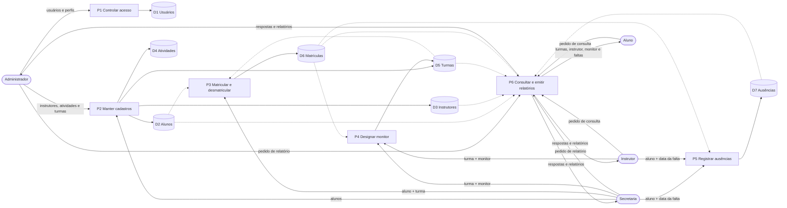

# Diagrama de Fluxo de Dados (DFD) orientado a eventos

O DFD mostra como a informação circula no sistema: quem envia dados, o que o sistema faz com eles e onde ficam guardados.

Legenda: retângulo = processo; cilindro = depósito de dados; elipse arredondada = ator externo; seta contínua = dado que entra, é gravado ou sai; seta tracejada = leitura de dados.

## 1. Depósitos de dados

| ID | Depósito | Tabela correspondente |
|---|---|---|
| D1 | Usuários | Usuario |
| D2 | Alunos | Aluno |
| D3 | Instrutores | Instrutor, Telefone_Instrutor |
| D4 | Atividades | Atividade |
| D5 | Turmas | Turma |
| D6 | Matrículas | Matricula_Turma |
| D7 | Ausências | Ausencia |

## 2. Eventos e processos

Cada evento é algo que acontece na academia e faz o sistema agir.

| Evento | Ator | O que acontece | Processo | Depósitos |
|---|---|---|---|---|
| E01 | Administrador | Cria um usuário e define o perfil dele | P1 Controlar acesso | Grava D1 |
| E02 | Todos | Faz login no sistema | P1 Controlar acesso | Lê D1 |
| E03 | Administrador | Cadastra instrutor, atividade ou turma | P2 Manter cadastros | Grava D3, D4, D5 |
| E04 | Secretaria | Cadastra um aluno | P2 Manter cadastros | Grava D2 |
| E05 | Administrador / Secretaria | Exclui um cadastro (o sistema bloqueia se houver vínculos, RN17) | P2 Manter cadastros | Lê D5, D6 / Atualiza D2 a D5 |
| E06 | Secretaria | Matricula um aluno em uma turma | P3 Matricular e desmatricular | Lê D2, D5 / Grava D6 |
| E07 | Secretaria | Desmatricula um aluno de uma turma | P3 Matricular e desmatricular | Atualiza D6 |
| E08 | Instrutor / Secretaria | Designa o aluno monitor da turma | P4 Designar monitor | Lê D6 / Atualiza D5 |
| E09 | Instrutor / Secretaria | Registra a falta de um aluno em uma data | P5 Registrar ausências | Lê D6 / Grava D7 |
| E10 | Instrutor | Consulta os alunos da turma | P6 Consultar e emitir relatórios | Lê D2, D5, D6 |
| E11 | Secretaria / Administrador | Pede um relatório | P6 Consultar e emitir relatórios | Lê D2, D3, D5, D6, D7 |
| E12 | Aluno | Consulta suas turmas, instrutor, monitor e faltas | P6 Consultar e emitir relatórios | Lê D3, D5, D6, D7 |

## 3. Nível 0: diagrama de contexto

O sistema como uma única caixa, com quem conversa com ele.

## 4. Nível 1: processos do sistema

A caixa do sistema aberta em 6 processos.

O login de todos os usuários também passa pelo P1, que consulta o D1 para liberar o acesso conforme o perfil.
