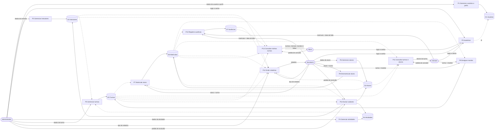

# Diagrama de Fluxo de Dados (DFD) orientado a eventos

Ordem deste documento: 1) depósitos de dados, 2) eventos, 3) diagrama.

## 1. Depósitos de dados

| ID | Depósito | Tabela correspondente |
|---|---|---|
| D1 | Usuários | Usuario |
| D2 | Alunos | Aluno |
| D3 | Instrutores (e telefones) | Instrutor, Telefone_Instrutor |
| D4 | Atividades | Atividade |
| D5 | Turmas | Turma |
| D6 | Matrículas | Matricula_Turma |
| D7 | Ausências | Ausencia |

## 2. Eventos

| Evento | Ator | Entrada (fluxo) | Processo | Depósitos | Saída |
|---|---|---|---|---|---|
| E01 | Administrador | Dados do usuário + perfil | P1 Gerenciar usuários e perfis | Grava D1 | Confirmação |
| E02 | Todos | Login e senha | P2 Autenticar | Lê D1 | Acesso liberado conforme o perfil |
| E03 | Administrador | Dados do instrutor | P3 Gerenciar instrutores | Grava D3 | Confirmação |
| E04 | Administrador | Dados da atividade | P4 Gerenciar atividades | Grava D4 | Confirmação |
| E05 | Administrador | Dados da turma | P5 Gerenciar turmas | Lê D3, D4 / Grava D5 | Confirmação |
| E06 | Secretaria | Dados do aluno | P6 Gerenciar alunos | Grava D2 | Código de matrícula gerado |
| E07 | Secretaria | Aluno + turma | P7 Matricular aluno | Lê D2, D5 / Grava D6 | Confirmação da matrícula |
| E08 | Secretaria | Aluno + turma | P8 Desmatricular aluno | Lê D5 / Atualiza D6 | Confirmação |
| E09 | Instrutor / Secretaria | Turma + aluno monitor | P9 Designar monitor | Lê D6 / Atualiza D5 | Confirmação |
| E10 | Instrutor / Secretaria | Matrícula + data da falta | P10 Registrar ausência | Lê D6 / Grava D7 | Confirmação |
| E11 | Instrutor | Pedido de consulta | P11 Consultar turmas e alunos | Lê D5, D6, D2 | Lista de alunos da turma |
| E12 | Secretaria / Administrador | Tipo de relatório | P12 Emitir relatórios | Lê D5, D6, D7, D2, D3 | Relatório |
| E13 | Aluno | Pedido de consulta | P13 Consultar minhas turmas | Lê D6, D5, D3, D7 | Turmas, horários, instrutor, monitor e faltas |
| E14 | Administrador / Secretaria | Pedido de exclusão | P14 Excluir cadastro | Lê D5, D6 / Atualiza D2, D3, D4, D5 | Confirmação ou bloqueio (RN17) |

## 3. Diagrama

Setas contínuas gravam ou enviam dados; setas tracejadas são leituras.

## 4. Arquivos do diagrama

- `dfd-eventos.drawio` (editável, draw.io)
- `dfd-eventos.png` (imagem)
