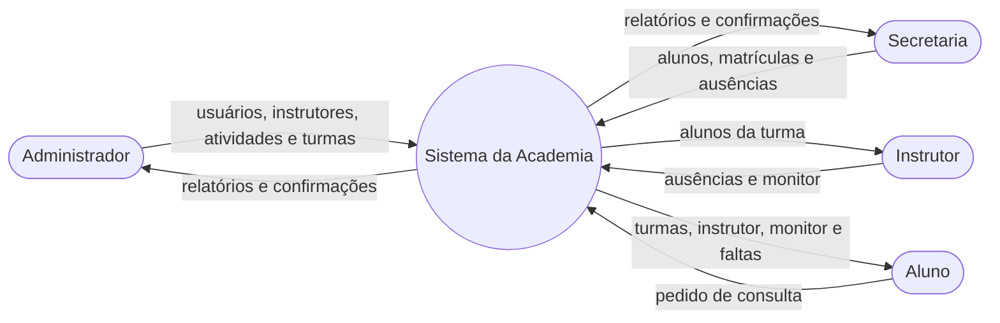
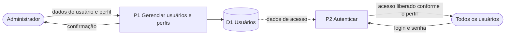
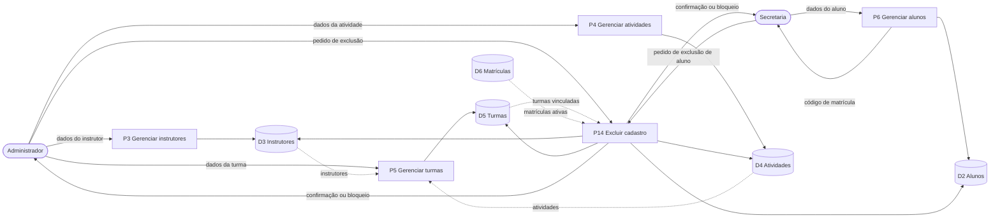
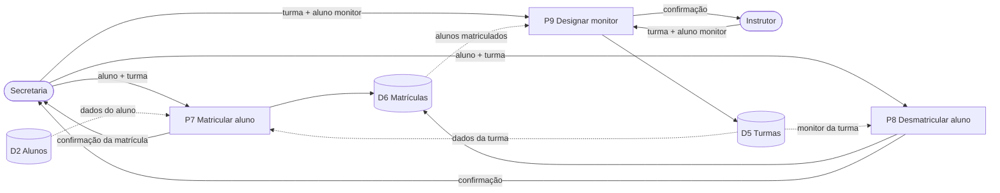
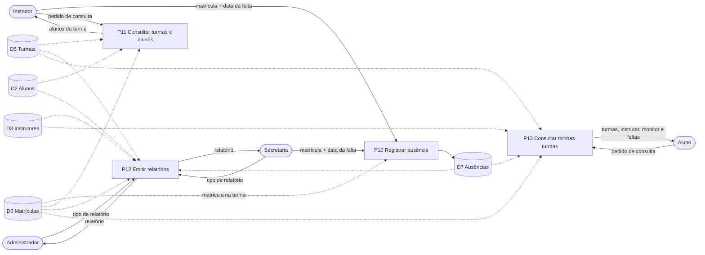

# Diagramas de Fluxo de Dados (DFD) orientados a eventos

O DFD está organizado em **níveis**, do mais geral ao mais detalhado:

| Nível | Diagrama | Conteúdo |
|---|---|---|
| 0 | Contexto | O sistema como uma única caixa e seus quatro atores |
| 1-A | Acesso e usuários | P1, P2 |
| 1-B | Cadastros | P3, P4, P5, P6, P14 |
| 1-C | Matrículas e monitor | P7, P8, P9 |
| 1-D | Frequência, consultas e relatórios | P10, P11, P12, P13 |

Legenda dos diagramas: retângulo = processo; cilindro = depósito de dados; elipse arredondada = ator externo; seta contínua = dado que entra, é gravado ou sai; seta tracejada = leitura de dados.

## 1. Depósitos de dados

| ID | Depósito | Tabela correspondente |
|---|---|---|
| D1 | Usuários | Usuario |
| D2 | Alunos | Aluno |
| D3 | Instrutores (e telefones) | Instrutor, Telefone_Instrutor |
| D4 | Atividades | Atividade |
| D5 | Turmas | Turma |
| D6 | Matrículas | Matricula_Turma |
| D7 | Ausências | Ausencia |

## 2. Eventos

| Evento | Ator | Entrada (fluxo) | Processo | Depósitos | Saída | Diagrama |
|---|---|---|---|---|---|---|
| E01 | Administrador | Dados do usuário + perfil | P1 Gerenciar usuários e perfis | Grava D1 | Confirmação | 1-A |
| E02 | Todos | Login e senha | P2 Autenticar | Lê D1 | Acesso liberado conforme o perfil | 1-A |
| E03 | Administrador | Dados do instrutor | P3 Gerenciar instrutores | Grava D3 | Confirmação | 1-B |
| E04 | Administrador | Dados da atividade | P4 Gerenciar atividades | Grava D4 | Confirmação | 1-B |
| E05 | Administrador | Dados da turma | P5 Gerenciar turmas | Lê D3, D4 / Grava D5 | Confirmação | 1-B |
| E06 | Secretaria | Dados do aluno | P6 Gerenciar alunos | Grava D2 | Código de matrícula gerado | 1-B |
| E07 | Secretaria | Aluno + turma | P7 Matricular aluno | Lê D2, D5 / Grava D6 | Confirmação da matrícula | 1-C |
| E08 | Secretaria | Aluno + turma | P8 Desmatricular aluno | Lê D5 / Atualiza D6 | Confirmação | 1-C |
| E09 | Instrutor / Secretaria | Turma + aluno monitor | P9 Designar monitor | Lê D6 / Atualiza D5 | Confirmação | 1-C |
| E10 | Instrutor / Secretaria | Matrícula + data da falta | P10 Registrar ausência | Lê D6 / Grava D7 | Confirmação | 1-D |
| E11 | Instrutor | Pedido de consulta | P11 Consultar turmas e alunos | Lê D5, D6, D2 | Lista de alunos da turma | 1-D |
| E12 | Secretaria / Administrador | Tipo de relatório | P12 Emitir relatórios | Lê D2, D3, D5, D6, D7 | Relatório | 1-D |
| E13 | Aluno | Pedido de consulta | P13 Consultar minhas turmas | Lê D3, D5, D6, D7 | Turmas, horários, instrutor, monitor e faltas | 1-D |
| E14 | Administrador / Secretaria | Pedido de exclusão | P14 Excluir cadastro | Lê D5, D6 / Atualiza D2, D3, D4, D5 | Confirmação ou bloqueio (RN17) | 1-B |

## 3. Nível 0: diagrama de contexto

## 4. Nível 1-A: Acesso e usuários

## 5. Nível 1-B: Cadastros

## 6. Nível 1-C: Matrículas e monitor

## 7. Nível 1-D: Frequência, consultas e relatórios

## 8. Arquivos do diagrama

- `dfd-eventos.drawio` (editável, draw.io; uma página para cada diagrama)
- Imagens PNG exportadas dos diagramas
