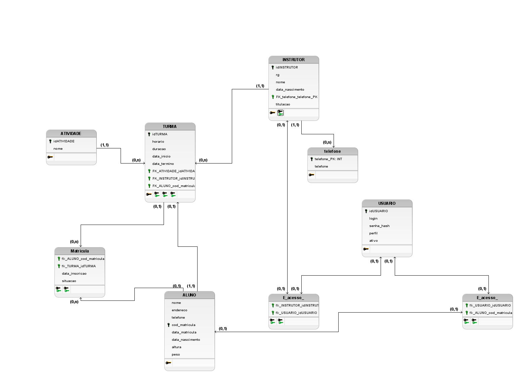

# Modelo Lógico de Dados

Este documento reúne os diagramas conceitual e lógico (elaborados no brModelo) e a descrição completa das tabelas, com atributos, chaves e cardinalidades.

## Diagramas

### Modelo conceitual

Elaborado no brModelo (arquivo editável na pasta `anexos`). Mostra as entidades, seus atributos e as cardinalidades (mínimo, máximo) de cada relacionamento.

### Modelo lógico (gerado no brModelo)

Gerado a partir do conceitual. Observações sobre este diagrama:

- As duas tabelas **E_acesso_** representam a ligação do Usuario com o Instrutor e com o Aluno. No modelo físico (pasta `04-der`), essas ligações foram simplificadas e incorporadas como chaves estrangeiras opcionais dentro da tabela Usuario.
- Não aparecem no diagrama, mas estão descritas na seção 1 deste documento e implementadas no modelo físico: a tabela **Telefone_Instrutor** (um instrutor pode ter vários telefones), a tabela **Ausencia** (uma linha por data de falta de cada matrícula) e os atributos `data_inscricao` e `situacao` da tabela **Matricula_Turma**.
- O diagrama mostra (0,1) nas ligações da Matricula; a cardinalidade correta é (1,1), pois cada matrícula pertence a exatamente uma turma e um aluno.

### Correspondência de nomes

O modelo físico (DBDesigner) usa a nomenclatura do programa. Os nomes equivalentes são:

| Neste documento | No diagrama do DBDesigner |
|---|---|
| id_atividade | idATIVIDADE |
| id_instrutor | idINSTRUTOR |
| id_turma | idTURMA |
| id_usuario | idUSUARIO |
| cod_matricula | cod_matricula |

## 1. Entidades, atributos e chaves

### Atividade
| Atributo | Tipo | Chave / Restrição | Observação |
|---|---|---|---|
| id_atividade | inteiro | PK | gerado automaticamente |
| nome | texto (60) | UK, NN | tipo de atividade (ex.: Natação) |

### Instrutor
| Atributo | Tipo | Chave / Restrição | Observação |
|---|---|---|---|
| id_instrutor | inteiro | PK | gerado automaticamente |
| rg | texto (20) | UK, NN | RN12 |
| nome | texto (100) | NN | |
| data_nascimento | data | NN | |
| titulacao | texto (50) | NN | |

### Telefone_Instrutor
| Atributo | Tipo | Chave / Restrição | Observação |
|---|---|---|---|
| id_instrutor | inteiro | PK, FK → Instrutor | RN14 (um instrutor, vários telefones) |
| numero | texto (20) | PK | |

### Aluno
| Atributo | Tipo | Chave / Restrição | Observação |
|---|---|---|---|
| cod_matricula | inteiro | PK | gerado automaticamente (RN13) |
| data_matricula | data | NN | data de entrada na academia |
| nome | texto (100) | NN | |
| endereco | texto (150) | NN | |
| telefone | texto (20) | NN | |
| data_nascimento | data | NN | |
| altura | decimal (3,2) | NN | em metros |
| peso | decimal (5,2) | NN | em kg |

### Turma
| Atributo | Tipo | Chave / Restrição | Observação |
|---|---|---|---|
| id_turma | inteiro | PK | gerado automaticamente |
| id_atividade | inteiro | FK → Atividade, NN | RN01 |
| id_instrutor | inteiro | FK → Instrutor, NN | RN02 |
| horario | hora | NN | horário da aula |
| duracao_min | inteiro | NN | duração da aula, em minutos |
| data_inicio | data | NN | |
| data_termino | data | NN | deve ser maior que data_inicio (RN11) |
| cod_matricula_monitor | inteiro | UK, FK composta → Matricula_Turma(id_turma, cod_matricula) | RN06, RN07, RN08 |

O **número de alunos não é atributo**: é calculado contando as matrículas ativas da turma (RN10).

### Matricula_Turma (tabela associativa)
| Atributo | Tipo | Chave / Restrição | Observação |
|---|---|---|---|
| id_turma | inteiro | PK, FK → Turma | |
| cod_matricula | inteiro | PK, FK → Aluno | |
| data_inscricao | data | NN | data em que entrou na turma |
| situacao | texto | NN (ATIVA ou CANCELADA) | permite desmatricular sem perder o histórico |

A PK composta impede o aluno de se matricular duas vezes na mesma turma (RN05).

### Ausencia
| Atributo | Tipo | Chave / Restrição | Observação |
|---|---|---|---|
| id_turma | inteiro | PK, FK composta → Matricula_Turma | |
| cod_matricula | inteiro | PK, FK composta → Matricula_Turma | |
| data_falta | data | PK | impede repetir a mesma data (RN16) |

O total de faltas é calculado com `COUNT(*)` (RN09).

### Usuario
| Atributo | Tipo | Chave / Restrição | Observação |
|---|---|---|---|
| id_usuario | inteiro | PK | gerado automaticamente |
| login | texto (50) | UK, NN | |
| senha_hash | texto (255) | NN | senha criptografada (RNF03) |
| perfil | texto | NN (ADMINISTRADOR, SECRETARIA, INSTRUTOR ou ALUNO) | RN19, RN21 |
| ativo | lógico | NN | conta desativada, não apagada (RN20) |
| id_instrutor | inteiro | UK, FK → Instrutor (opcional) | preenchido só se perfil = INSTRUTOR |
| cod_matricula | inteiro | UK, FK → Aluno (opcional) | preenchido só se perfil = ALUNO |

## 2. Relacionamentos e cardinalidades

| Relacionamento | Cardinalidade | Como é implementado |
|---|---|---|
| Atividade — Turma | 1:N (uma atividade, várias turmas) | FK id_atividade em Turma |
| Instrutor — Turma | 1:N | FK id_instrutor em Turma |
| Instrutor — Telefone_Instrutor | 1:N | FK id_instrutor em Telefone_Instrutor |
| Aluno — Turma | N:N | tabela associativa Matricula_Turma |
| Matricula_Turma — Ausencia | 1:N | FK composta em Ausencia |
| Turma — Aluno monitor | 1:1 (uma turma, um monitor; aluno monitora no máximo uma turma) | FK composta + UK em Turma |
| Usuario — Instrutor | 1:1 opcional | FK única em Usuario |
| Usuario — Aluno | 1:1 opcional | FK única em Usuario |

## 3. Onde cada regra de negócio é garantida

| Regra | Garantida por |
|---|---|
| RN01, RN02 | FK NN em Turma |
| RN05 | PK composta de Matricula_Turma |
| RN06 | monitor obrigatório: validação da aplicação (ver nota abaixo) |
| RN07 | UK em cod_matricula_monitor |
| RN08 | FK composta (id_turma, cod_matricula_monitor) → Matricula_Turma |
| RN09, RN16 | Ausencia com PK composta incluindo a data; total por COUNT |
| RN10 | calculado, sem atributo |
| RN11 | CHECK (data_termino > data_inicio) |
| RN12, RN13 | UK em rg; chave gerada automaticamente |
| RN14 | tabela Telefone_Instrutor |
| RN15, RN17, RN18, RN19, RN20, RN21 | aplicação (regras de acesso e fluxo) apoiadas por FKs e pelo campo perfil/ativo |

**Nota sobre o monitor (RN06):** o monitor precisa estar matriculado na turma, e a matrícula só existe depois que a turma é criada. Por isso `cod_matricula_monitor` é **opcional no banco** (aceita vazio) e a aplicação exige a designação antes de a turma começar a funcionar. Essa decisão é uma premissa do projeto.
