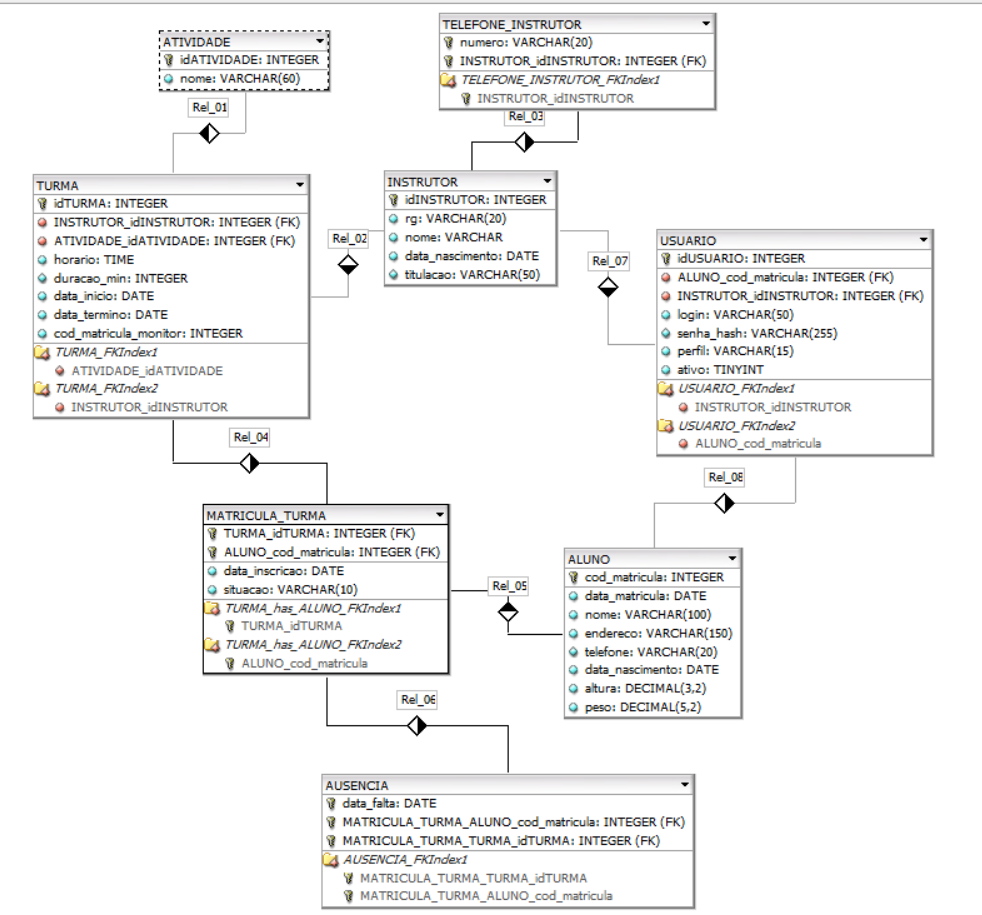

# Modelo Físico: Diagrama Entidade-Relacionamento (DER)

Diagrama elaborado no DBDesigner (arquivo editável na pasta `anexos`). Mostra as tabelas com os tipos de dados do MySQL, as chaves primárias e estrangeiras e os índices.

## Tabelas

Atividade, Instrutor, Telefone_Instrutor, Aluno, Turma, Matricula_Turma, Ausencia e Usuario.

## Observações

- A chave estrangeira composta do monitor (Turma → Matricula_Turma), as restrições UNIQUE (RG do instrutor e login) e os CHECK (data de término e perfil) não aparecem no desenho e serão definidos no DDL (`05-ddl`).
- O campo `cod_matricula_monitor` da Turma aceita valor nulo: a turma é criada antes das matrículas, e o sistema exige a designação do monitor antes de ela funcionar (RN06).
- As colunas de chave estrangeira de Usuario (aluno e instrutor) também aceitam nulo, pois administrador e secretaria não são alunos nem instrutores.
- O número de alunos de cada turma não é coluna: é calculado pela contagem das matrículas (RN10), e o total de faltas pela contagem das ausências (RN09).
- Correspondência de nomes com o modelo lógico: ver `03-modelo-logico/modelo-logico.md`.
