# Interface do Sistema

Sistema web responsivo (computador e celular). O protótipo das telas está no Figma (ver `07-prototipo-figma`).

## 1. Interface por perfil

Cada perfil de usuário enxerga um **menu diferente**, definido no login (RN19, RN21). A tela de login é a mesma para todos; depois dela, o sistema abre o menu do perfil.

| Opção do menu | Administrador | Secretaria | Instrutor | Aluno |
|---|---|---|---|---|
| Usuários e perfis | ✅ | | | |
| Instrutores | ✅ | | | |
| Atividades | ✅ | | | |
| Turmas (cadastro) | ✅ | | | |
| Alunos | ✅ | ✅ | | |
| Matrículas e monitor | ✅ | ✅ | ✅ (só monitor, nas suas turmas) | |
| Ausências | ✅ | ✅ | ✅ (suas turmas) | |
| Consultar alunos da turma | ✅ | ✅ | ✅ (suas turmas) | |
| Relatórios | ✅ | ✅ | | |
| Minhas turmas e faltas | | | | ✅ |

## 2. Fluxo de navegação

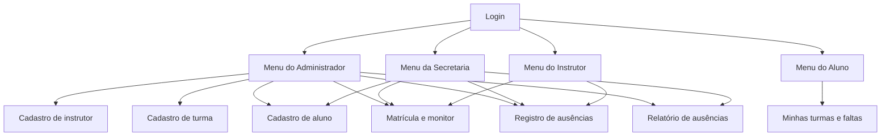

## 3. Telas de cadastro

### 3.1 Cadastro de aluno (Administrador e Secretaria) — RF03

| Campo | Tipo | Observação |
|---|---|---|
| Código de matrícula | texto (somente leitura) | gerado pelo sistema (RN13) |
| Data de matrícula | data | |
| Nome | texto | obrigatório |
| Endereço | texto | obrigatório |
| Telefone | texto | obrigatório |
| Data de nascimento | data | obrigatório |
| Altura (m) | número | obrigatório |
| Peso (kg) | número | obrigatório |

Botões: **Salvar**, **Cancelar**, **Excluir** (bloqueado se o aluno tiver matrículas, RN17).

### 3.2 Cadastro de instrutor (Administrador) — RF02

| Campo | Tipo | Observação |
|---|---|---|
| RG | texto | obrigatório, único (RN12) |
| Nome | texto | obrigatório |
| Data de nascimento | data | obrigatório |
| Titulação | texto | obrigatório |
| Telefones | lista | botões **Adicionar** e **Remover** (RN14) |

Botões: **Salvar**, **Cancelar**, **Excluir** (bloqueado se o instrutor tiver turmas, RN17).

### 3.3 Cadastro de turma (Administrador) — RF05

| Campo | Tipo | Observação |
|---|---|---|
| Atividade | lista de seleção | obrigatório (RN01) |
| Instrutor | lista de seleção | obrigatório (RN02) |
| Horário da aula | hora | obrigatório |
| Duração (minutos) | número | obrigatório |
| Data de início | data | obrigatório |
| Data de término | data | deve ser posterior ao início (RN11) |
| Número de alunos | número (somente leitura) | calculado pelas matrículas (RN10) |
| Monitor | texto (somente leitura) | definido na tela de matrícula e monitor |

Botões: **Salvar**, **Cancelar**, **Excluir** (bloqueado se a turma tiver matrículas, RN17).

## 4. Telas de consulta e diálogo

### 4.1 Login — RF01

Campos: **Usuário** e **Senha**. Botão **Entrar**. Mensagem de erro para login inválido ou conta desativada.

### 4.2 Matrícula e monitor (Administrador, Secretaria e Instrutor) — RF06, RF07, RF08

1. Seleciona a **turma** (o instrutor só vê as suas).
2. A tela mostra a **lista de alunos matriculados**, com o monitor destacado.
3. Botão **Matricular aluno** (busca por nome ou código) e botão **Desmatricular** (Administrador e Secretaria).
4. Botão **Definir como monitor** ao lado de cada aluno matriculado (RN06, RN07, RN08). Se o monitor for desmatriculado, o sistema exige escolher outro (RN15).

### 4.3 Registro de ausências (Administrador, Secretaria e Instrutor) — RF09, RF12

1. Seleciona a **turma** e o **aluno**.
2. Informa a **data da falta** e clica em **Registrar**.
3. Abaixo, aparece a **lista de faltas** do aluno nessa turma, com o **total de ausências** calculado (RN09). Mensagem de erro se a data for repetida ou fora do período da turma (RN16).

### 4.4 Minhas turmas e faltas (Aluno) — RF14, RF15

Um cartão para cada turma em que o aluno está matriculado, mostrando: **atividade, horário, nome do instrutor, nome do monitor e total de faltas**. Botão **Ver datas das faltas**. Nenhum outro dado pessoal de instrutores ou de outros alunos é exibido (RN18).

## 5. Layout de relatório

### 5.1 Relatório de ausências por turma (Administrador e Secretaria) — RF13

```
-------------------------------------------------------------
RELATÓRIO DE AUSÊNCIAS POR TURMA
Turma: Natação - terça, 18h      Instrutor: Carlos Souza
Período: 01/03/2026 a 30/06/2026
-------------------------------------------------------------
Cód. matrícula | Aluno            | Total de faltas
-------------------------------------------------------------
1001           | Maria Silva      | 3
1002           | João Santos      | 0
-------------------------------------------------------------
Total de alunos: 2          Emitido em: 18/11/2026
-------------------------------------------------------------
```

Filtros: turma (obrigatório) e período (opcional). Opção de **imprimir** ou **exportar**.

## 6. Telas do protótipo

Telas exportadas do Figma. O protótipo navegável está em `07-prototipo-figma/prototipo.md`.

### Acesso e menus por perfil

**Login**

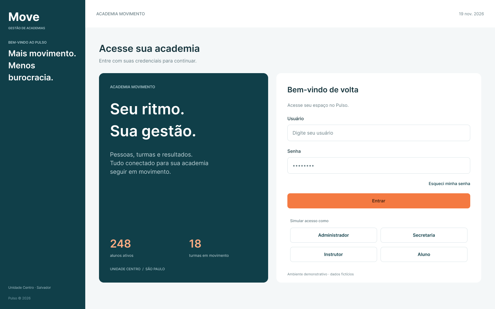

**Menu do Administrador**

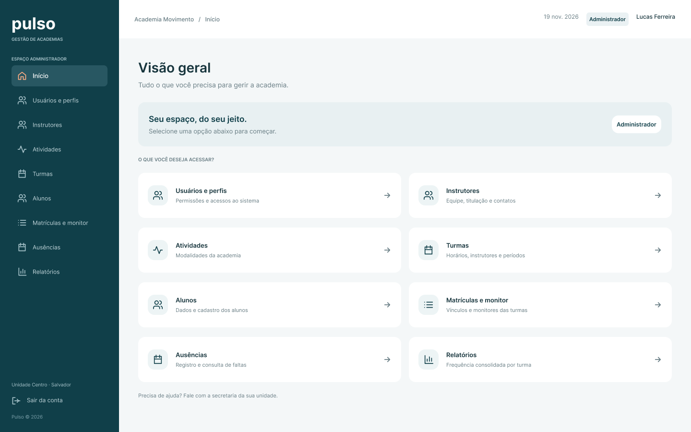

**Menu da Secretaria**

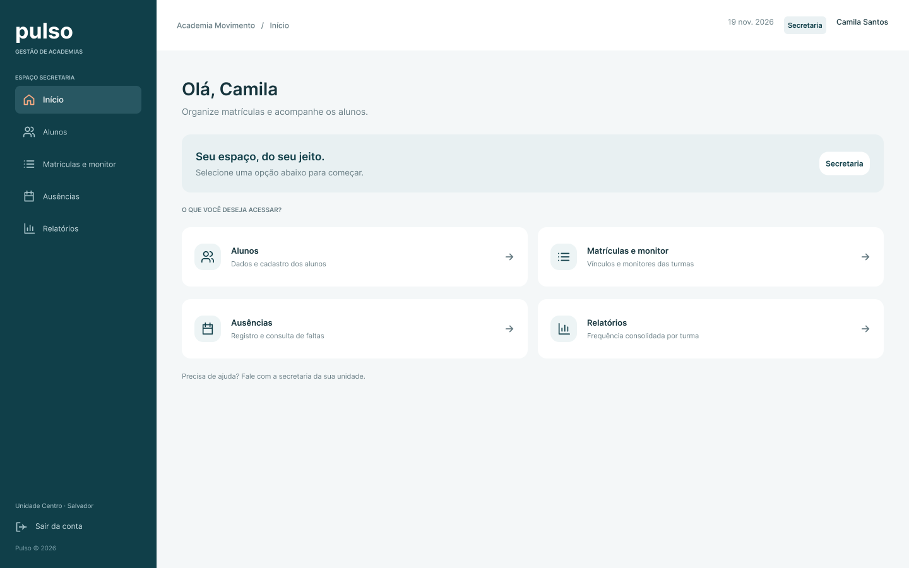

**Menu do Instrutor**

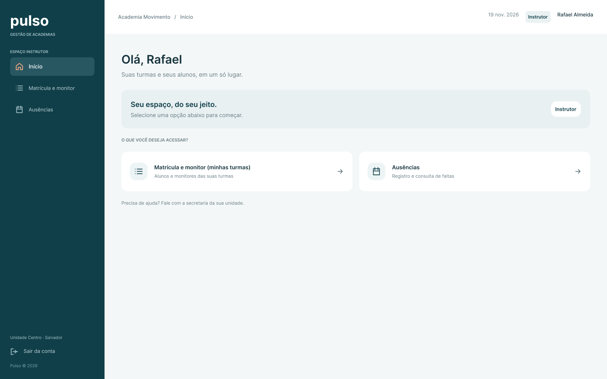

**Menu do Aluno**

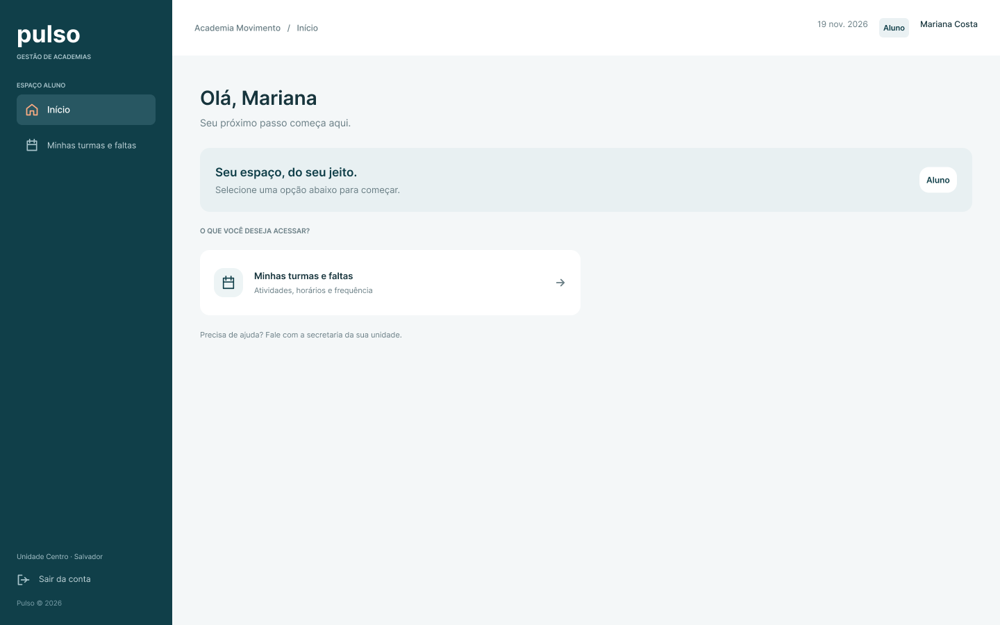

### Telas de cadastro

**Cadastro de aluno**

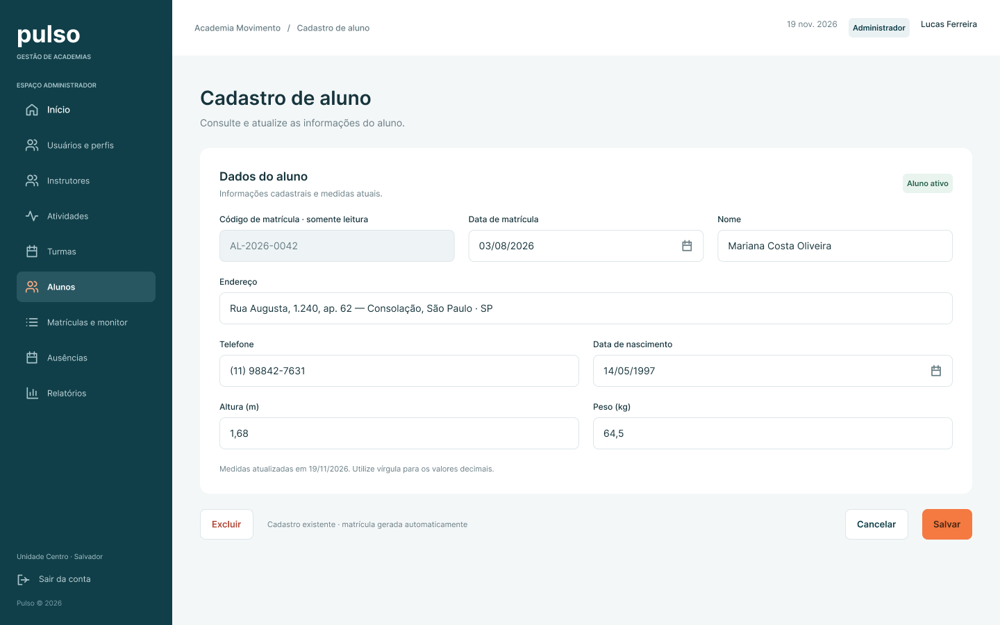

**Cadastro de instrutor**

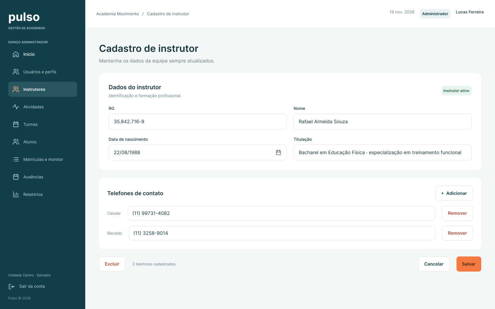

**Cadastro de turma**

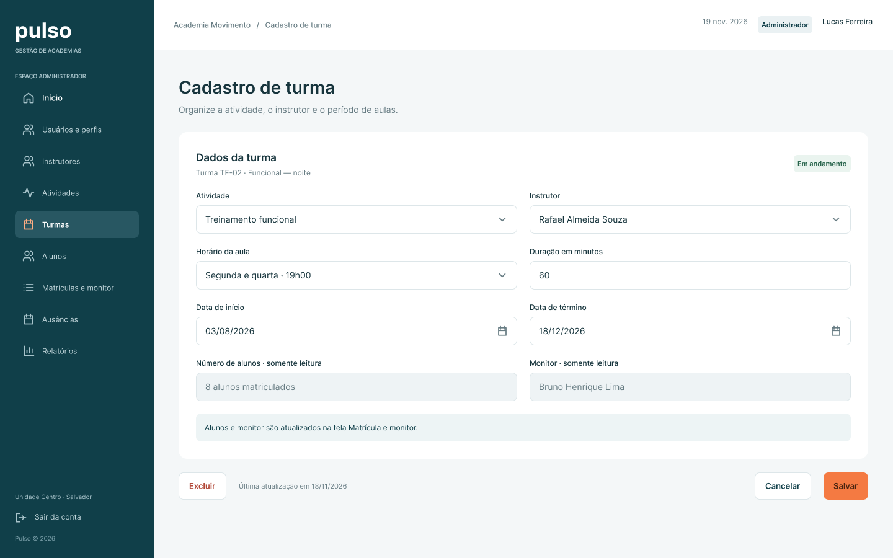

### Telas de consulta e diálogo

**Matrícula e monitor**

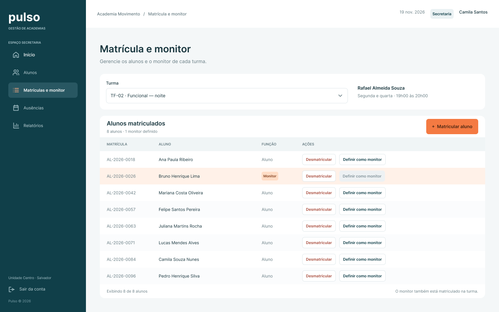

**Registro de ausências**

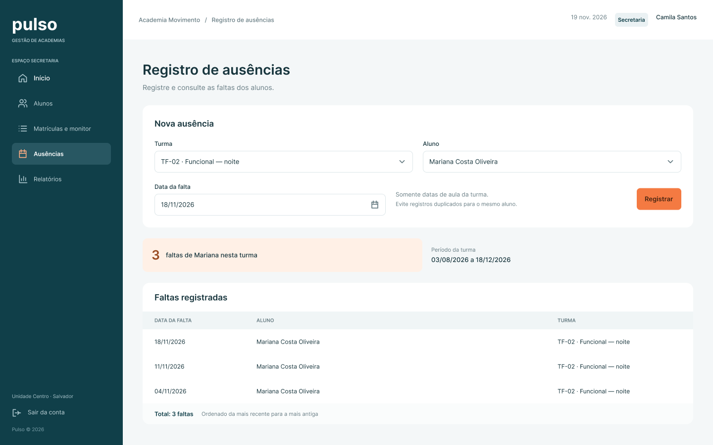

**Minhas turmas e faltas (Aluno)**

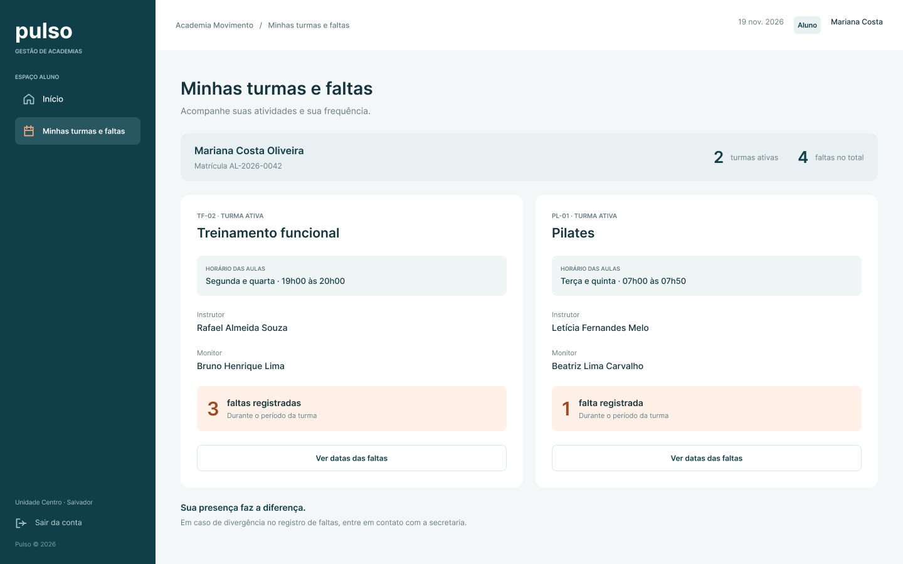

### Layout de relatório

**Relatório de ausências por turma**

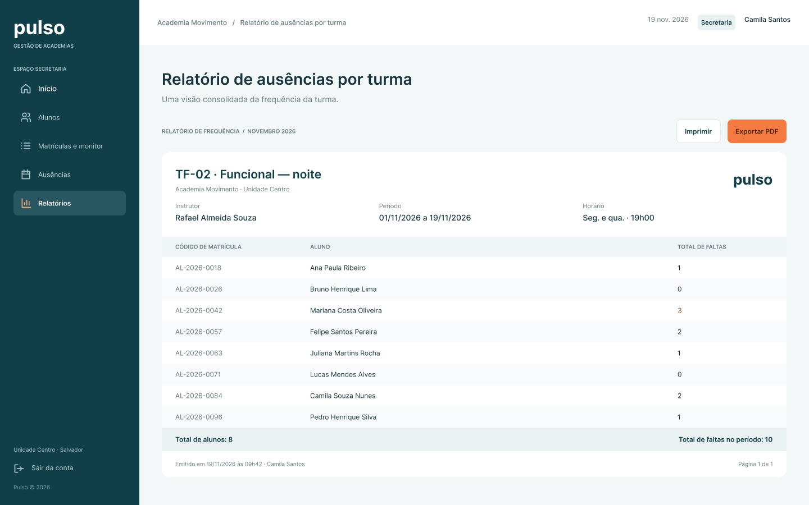
